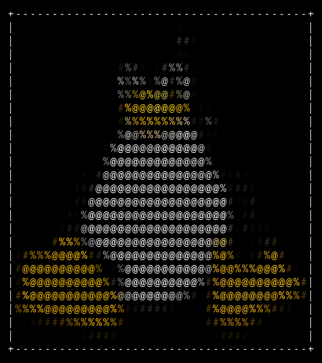

<div align="center">
<pre>
                          _&nbsp;&nbsp;&nbsp;
  __ _ ___  ___ __ _ _ __| |_&nbsp;
 / _` / __|/ __/ _` | '__| __|
| (_| \__ \ (_| (_| | |  | |_&nbsp;
 \__,_|___/\___\__,_|_|   \__|
</pre>
</div>

ascart creates text banners and turns images, GIFs, videos, and live camera feeds into ASCII art.<br>
Features include colour, custom characters, terminal fitting, and multiple export formats.<br>
A learning project built with Python.

[Installation](#installation) · [Preview](#preview) · [Command guide](#command-guide) · [Text](#text-commands) · [Images](#image-commands) · [GIFs](#gif-commands) · [Videos](#video-commands) · [Camera](#camera-commands-experimental) · [License and credits](#license-and-credits)

## Installation

You need Python 3.11+, Git, and [pipx](https://pipx.pypa.io/stable/how-to/install-pipx.html).

On Ubuntu/Debian:

```bash
sudo apt update
sudo apt install pipx
pipx ensurepath
```

On Fedora:

```bash
sudo dnf install pipx
pipx ensurepath
```

On macOS with Homebrew:

```bash
brew install pipx
pipx ensurepath
```

On [Windows](https://pipx.pypa.io/stable/how-to/install-pipx.html#windows) (PowerShell, with Python's `py` launcher installed):

```powershell
py -m pip install --user pipx
py -m pipx ensurepath
```

For other systems, follow the [pipx installation guide](https://pipx.pypa.io/stable/how-to/install-pipx.html).

Open a new terminal after `ensurepath`, then install and run:

```bash
pipx install git+https://github.com/MohitSaini127/ascart.git
ascart -t "HI"
```

After installation, run `ascart` from any folder. No manual environment activation is needed.

## Preview

Examples generated by ascart. See the [command guide](#command-guide) for more options.

### Standard text

```bash
ascart --text "ascart"
```

```text
                          _
  __ _ ___  ___ __ _ _ __| |_
 / _` / __|/ __/ _` | '__| __|
| (_| \__ \ (_| (_| | |  | |_
 \__,_|___/\___\__,_|_|   \__|
```

### Slanted text

```bash
ascart --text-slant "ascart"
```

```text
                              __
  ____ _______________ ______/ /_
 / __ `/ ___/ ___/ __ `/ ___/ __/
/ /_/ (__  ) /__/ /_/ / /  / /_
\__,_/____/\___/\__,_/_/   \__/
```

### Image to ASCII

The included [Tux sample](#photo-conversion), converted into colored ASCII characters:

```bash
ascart examples/image1.png --width 40 --color --border --background dark
```

<p align="center">
  
</p>

The image preserves the colors on GitHub. It was saved with ascart's PNG output; terminal appearance depends on your font and theme.

## Working features

- Standard, slanted, bold-looking, and named-font text banners, with width wrapping and TXT/PNG/HTML saving.
- Photo-to-ASCII conversion, with a default width of 60 characters.
- Custom output width or optional fitting to terminal width and height.
- Optional ASCII borders for photos, text banners, GIFs, and videos.
- Custom printable ASCII character palettes.
- RGB foreground color output with a denser default palette.
- Light/dark background mapping, with basic automatic selection and manual overrides.
- Saving photo conversions as plain text, PNG pictures, or selectable HTML artwork, including optional colors and borders.
- GIF playback once, continuously, or for a specified number of playbacks.
- Saving GIF input as an animated ASCII GIF containing one complete animation, set to play once.
- Video playback once, continuously, or for a specified number of playbacks, converting one frame at a time with optional color and terminal fitting.
- Saving video input as a silent ASCII MP4, processing one frame at a time and keeping terminal loops separate.
- Animated, selectable HTML export for GIFs and videos, with Play, Pause, and Replay controls.
- Experimental live local-camera ASCII, TXT/PNG/HTML snapshots, and timed GIF/HTML/silent MP4 recording, with camera selection, access checking, a snapshot countdown, and Ctrl+C cleanup. Hardware compatibility needs checking on your own machine.
- Readable messages for common input, decoding, and file-saving errors.

## Setup

This setup is for working on the source code. For everyday use without manual environment activation, follow [Installation](#installation).

The project declares Python 3.10 or newer and these dependencies:

| Package | Purpose | Declared version |
| --- | --- | --- |
| Pillow | Read photos/GIFs, resize frames, get brightness and RGB colors, and draw saved ASCII frames. | `>=13.0.0` |
| pyfiglet | Render text using character-based banner fonts. | `>=1.0.2,<2` |
| opencv-python-headless | Decode video frames and encode silent MP4 output through `cv2`, without desktop display windows. | `>=4.12,<5` |

OpenCV also installs NumPy, which represents frames as arrays of pixel values. Development has been checked with Python 3.14.8, Pillow 13.0.0, pyfiglet 1.0.4, OpenCV 4.14.0.94, and NumPy 2.5.4; other versions have not yet been verified.

From the project folder, on Linux/macOS with bash or zsh:

```bash
python3 -m venv .venv
source .venv/bin/activate
python -m pip install -e .
```

`venv` creates an isolated environment for project packages. Pip installs the dependencies above and an editable copy of ascart, making the `ascart` command available in that environment. Source-code edits take effect without reinstalling; changes to dependencies or command definitions may require rerunning the installation command.

Create the environment once. In a new terminal, enter the project folder and activate it again:

```bash
source .venv/bin/activate
```

Use `deactivate` to leave the environment. The `.venv/` folder stays on your computer and is ignored by Git.

## Command guide

After [installation](#installation), run these commands from any folder using your own media paths. Replace `animation.gif`, `video.mp4`, and `video.avi` with your own file paths. Image examples use `examples/image1.png`, which is available in a repository clone; pipx users should replace it with a path to their own image. Quote paths containing spaces. If using the [source setup](#setup) instead, activate that environment before running commands.

| General command | What it does |
| --- | --- |
| `ascart --help` | Shows the available options. |
| `ascart --version` | Prints the installed version and exits; no text or media input is needed. |
| `ascart -V` | Short form of `--version`; use a capital V. |

For this version, `ascart --version` and `ascart -V` both print `ascart 0.1.0`. Use a capital `V`; lowercase `-v` is not an option. The command reads installed package information. If you change the version in `pyproject.toml`, rerun `python -m pip install -e .` to refresh it. An uninstalled source checkout without package metadata reports `ascart unknown`; follow [setup](#setup) to install it.

[Text commands](#text-commands) · [Image commands](#image-commands) · [GIF commands](#gif-commands) · [Video commands](#video-commands) · [Camera commands](#camera-commands-experimental)

### Text commands

| Command | What it does |
| --- | --- |
| `ascart --text "Hello"` | Creates a standard text banner. |
| `ascart -t "Hello"` | Short form of `--text`; creates the same standard banner. |
| `ascart --text-slant "Hello"` | Creates a slanted banner. |
| `ascart --text-bold "Hello"` | Creates a banner with thicker letters. |
| `ascart --text-font-small "Hello"` | Uses the named `small` banner font. |
| `ascart --text "Hello world" --width 40` | Sets the banner's wrapping width. |
| `ascart --text "Hello" --border` | Adds an ASCII border. |
| `ascart --text "Hello" --output output/hello.txt` | Saves the banner as text and displays it. |
| `ascart --text-slant "Hello" --border --output output/hello.png` | Saves a bordered banner as a PNG and displays it. |
| `ascart -t "Hello" --border --output output/hello.html` | Saves a selectable banner as a webpage and displays it. |

### Image commands

| Command | What it does |
| --- | --- |
| `ascart examples/image1.png` | Converts the sample image at the default width of 60 characters. |
| `ascart examples/image1.png --width 40` | Uses 40 character columns. |
| `ascart examples/image1.png --fit` | Fits the artwork inside the terminal. |
| `ascart examples/image1.png --color` | Uses colors from the image. |
| `ascart examples/image1.png --border` | Adds an ASCII border. |
| `ascart examples/image1.png --chars " .:*#@"` | Uses your chosen character palette. |
| `ascart examples/image1.png --background light` | Adjusts the character mapping for a light background. |
| `ascart examples/image1.png --output output/image.txt` | Saves plain-text artwork and displays it. |
| `ascart examples/image1.png --color --border --output output/image.png` | Saves a colored, bordered PNG and displays the artwork. |
| `ascart examples/image1.png --color --border --output output/image.html` | Saves colored, selectable ASCII artwork as a webpage and displays it. |

### GIF commands

| Command | What it does |
| --- | --- |
| `ascart animation.gif` | Plays the GIF as ASCII once. |
| `ascart animation.gif --fit --color --border` | Plays colored, bordered artwork fitted to the terminal. |
| `ascart animation.gif --loop` | Repeats terminal playback until Ctrl+C. |
| `ascart animation.gif --loop-4` | Plays four times in the terminal. |
| `ascart animation.gif --color --border --output output/animation.html` | Saves one ASCII animation as an offline webpage with playback controls and an optional Loop checkbox. |
| `ascart animation.gif --color --output output/ascii.gif` | Saves one colored ASCII animation, then previews it. |
| `ascart animation.gif --loop-4 --output output/ascii-four.gif` | Saves one animation and previews it four times. |

### Video commands

| Command | What it does |
| --- | --- |
| `ascart video.mp4` | Plays the video as ASCII once, without audio. |
| `ascart video.mp4 --fit --color --border` | Plays colored, bordered artwork fitted to the terminal. |
| `ascart video.mp4 --loop` | Repeats terminal playback until Ctrl+C. |
| `ascart video.mp4 --loop-4` | Plays four times in the terminal. |
| `ascart video.mp4 --color --border --output output/video.html` | Saves one silent ASCII animation as an offline webpage with playback controls. |
| `ascart video.mp4 --color --output output/ascii.mp4` | Saves one silent ASCII video, then previews it. |
| `ascart video.mp4 --loop-4 --output output/ascii-four.mp4` | Saves one pass and previews it four times. |
| `ascart video.avi --output output/from-avi.mp4` | Converts a supported AVI video into an ASCII MP4. |

### Camera commands (experimental)

**Experimental:** camera access and performance depend on your hardware, drivers, operating system, and permissions. Some devices may fail to open or disconnect.

| Command | What it does |
| --- | --- |
| `ascart --list-cameras` | Tests local camera access and prints readable IDs; cameras may activate briefly. |
| `ascart --camera` | Opens camera 0 with the default horizontally flipped view in the same terminal. |
| `ascart --camera-mirrored` | Opens camera 0 with the alternative view, preserving the camera-supplied orientation. |
| `ascart --camera-mirrored 1 --color` | Opens camera 1 with the alternative orientation and colour. |
| `ascart --camera 1` | Opens camera ID 1 instead. |
| `ascart --camera --color --fit --border` | Shows coloured, bordered live ASCII fitted to the terminal. |
| `ascart --camera --width 60 --chars " .:*#@"` | Uses a fixed width and custom character palette. |
| `ascart --camera --background light` | Maps brightness for a light terminal theme. |
| `ascart --camera --output output/snapshot.txt` | Previews ASCII during a three-second countdown, then saves one plain frame and closes the camera. |
| `ascart --camera --color --width 120 --border --output output/snapshot.png` | Saves one coloured, bordered ASCII picture after the countdown. |
| `ascart --camera-mirrored --color --output output/snapshot.html` | Saves one selectable HTML snapshot in the alternative camera orientation. |
| `ascart --camera --color --camera-duration 10 --output output/camera.mp4` | Records 10 seconds of silent ASCII MP4 with a live terminal preview. |
| `ascart --camera --color --camera-duration 10 --output output/camera.gif` | Records one ASCII GIF animation; format memory limits apply. |
| `ascart --camera --color --camera-duration 10 --output output/camera.html` | Records selectable animated HTML with Play, Pause, Replay, and Loop controls. |
| `ascart --camera-mirrored 1 --fit --border --camera-duration 5 --output output/camera-alt.mp4` | Records camera 1 in the alternative orientation for 5 seconds. |

Press **Ctrl+C** to stop and release the camera. Add --output with a new .txt, .png, or .html filename to take one snapshot after a three-second countdown. To record an animation, supply --camera-duration SECONDS and a new .mp4, .gif, or .html filename; duration must be greater than zero and at most 300 seconds. Loop options are rejected. See [live camera details](#live-camera-experimental) for access and listing limitations.

Keep these rules in mind:

- Use a new output filename each time. Existing files are never overwritten, and output folders are created as needed. TXT output stays plain; PNG/HTML/GIF/MP4 output supports photo or frame colors.
- GIF and MP4 files store one complete animation. `--loop`, `--loop-4`, and `--loop-count 4` affect only terminal playback. Saved GIFs request one playback; video players control their own repeat settings.
- Terminal animation previews need an interactive terminal. Saving still works without one and skips playback. MP4 output has no audio.
- Use either `--width` or `--fit`. GIFs and videos also accept the image options for width, fitting, custom characters, and backgrounds. Text banners support width, border, and output, but reject media-only options such as color and fit.

## Usage notes

- Text banners accept printable ASCII text. Their width controls wrapping, not the size of individual letters; bold and slant are character designs that also survive plain-text saving.
- Custom palettes run from least to most visually dense. Defaults are ` .:-=+*#%@` for monochrome and `#%@` for colour. Light background mode reverses the character mapping, not the source colours; automatic detection is only a terminal hint.
- `--width` counts characters inside the border. Adding a border adds two columns and two rows. `--fit` reads the terminal size once; rerun after resizing.
- PNG and HTML use their own fonts, so saved artwork can look different from your terminal. GIF-file and video-file exports use a bitmap font; camera GIF/MP4 recordings use the smoother PNG font. GIF colours are limited to 256 per frame.
- HTML files work offline and keep the characters selectable. Animated pages open paused with Play, Pause, and Replay controls. GIF and camera-recording pages also have an optional Loop checkbox. Animated HTML requires JavaScript and is limited to 3,000 frames and 20 MiB.
- For values beginning with `-`, use the equals form: `--chars=-+@` or `--text=--loop-4`.

For output formats, playback details, size limits, and file errors, see the [usage reference](docs/usage.md).

## Photo conversion

The included sample is Tux, the Linux penguin, downloaded from [garrett/Tux](https://github.com/garrett/Tux). Its embedded metadata and the [source README](https://github.com/garrett/Tux/blob/main/README.md) state [CC0](https://creativecommons.org/publicdomain/zero/1.0/). Original illustration by Larry Ewing using GIMP; redrawn in Inkscape by Garrett LeSage, with refinement and cleanup credited upstream to IFo Hancroft. Only this PNG is bundled; supply your own files for GIF and video playback.

## Live camera (experimental)

Camera access and performance depend on hardware, drivers, and permissions. Broad compatibility, including Windows and macOS, has not been verified. `--list-cameras` reports readable IDs, not device names; Linux checks `/dev/video*`, while other systems probe IDs 0–9. Cameras may activate briefly during listing.

Good lighting and camera placement improve detail. All processing is local; camera frames are not uploaded. Device delays can extend the snapshot countdown or recording, and can delay Ctrl+C.

Camera GIF/MP4 recordings allow up to **300 seconds**. Camera HTML allows up to **200 seconds**, and its 20 MiB limit may be reached sooner. Saving and checking can continue after the countdown reaches zero; GIF exports show Encoding, Checking, and Copying progress.

For camera access, snapshot behaviour, and recording details, see the [camera reference](docs/usage.md#live-camera-experimental).

## Running tests

With the virtual environment active:

```bash
python -B -m unittest discover -s tests -v
python -m pip check
```

The suite checks video inspection, MP4/AVI decoding, color conversion, timing, counted and continuous playback, cleanup after interruption or failed restarts, rejected options, and selected photo/GIF/text regressions. It creates temporary media that is deleted afterward. The real decoding tests require working MP4 and MJPG encoders in OpenCV. Automated checks do not replace viewing the artwork in your own terminal.

Converter tests cover palette endpoints and boundaries, balanced band sizes, monotonic brightness mapping, custom and single-character palettes, and color/light-background behavior on a controlled grayscale image.

Border tests cover visible widths with ANSI colors, row padding, saved text, terminal margins, tiny-terminal errors, counted animation playback, and interruption cleanup.

PNG tests check smooth regular strokes with less ink than the previous bitmap sample, printable-character cell containment, bitmap fallback without FreeType, fixed character cells, blank rows/spaces, RGB strokes, light/dark canvases, neutral borders, all banner styles, uppercase extensions, the size limit, no-overwrite protection including links and competing creation, and readable save failures. GIF/video PNG export is rejected before creating output folders, including with loop options.

GIF export tests read back actual saved animations to check frame timing, source-loop removal, colors, borders, fitting, missing-timing fallback, merged identical frames, and independence from terminal loop counts. They also cover saving without an interactive terminal, completed-file preservation on playback interruption, wrong input/output combinations, existing-file/link protection, competing creation, truncated input, rendering failures, permission errors, and partial writes. Fixtures and outputs stay in temporary directories.

Camera GIF tests additionally cover streaming frame encoding and image cleanup, per-frame palettes, repeated-frame timing, and a width-140 recording exceeding the former 64-million-pixel aggregate budget. These checks use simulated cameras and reopen real GIF output.

The combination suite exercises 1,344 option combinations: 216 photo cases, 864 GIF cases (including expected non-interactive playback rejections), 216 real MP4 playback cases, and 48 text-banner cases. It crosses colors, borders, automatic/manual backgrounds, default/custom palettes, default/explicit/fitted sizing, supported save formats, terminal availability, and loop modes where applicable. It checks displayed grids and reopens saved files to verify dimensions, timing, and one-pass GIF metadata. Additional cases check invalid combinations, option-like text, background hints, and malformed paths. Source-media SHA-256 hashes must remain unchanged. This covers the listed scenarios; it is not a guarantee for every possible file or codec.

Short-text alias tests compare `-t` with `--text` across widths, borders, and terminal/TXT/PNG output, including identical saved contents. They also check help text, literal option-like text, invalid values, and incompatible input modes.

HTML tests parse exported pages to check selectable characters, escaping, whitespace/blank rows, colors and resets, neutral borders, and standalone markup. They include 48 photo-option combinations and 20 banner combinations, including -t, width, fitting, borders, backgrounds, and custom palettes with HTML-special characters. Other checks cover animated exports with terminal loop options, uppercase extensions, existing destinations/links, competing creation, rendering failures, permissions, partial writes, and unchanged source media.

MP4 export tests add 32 saved-video rendering combinations, reopen real encoded MP4s, and check dimensions, frame count, FPS, color order, source preservation, and temporary-file cleanup. They cover AVI input, terminal-loop independence, interrupted playback, non-interactive saving, unsupported format combinations, existing files and links, competing destination creation, unavailable/failing encoders, incomplete encoding, missing FPS, permission failures, source interruption, and partial-copy errors.

File-error tests use real truncated PNG/GIF data and invalid save paths, plus simulated permission and disk-space failures. They verify successful saving, rejection of existing destinations and source aliases, exclusive creation when another file appears during saving, and partial-new-file behavior. They also ensure unexpected programming errors are not hidden by a catch-all exception handler. Test media and outputs are created in temporary directories.

Animated HTML tests add 96 GIF/video option combinations, check exact converted frames and timings, escaping, initial-frame fallback, size/frame limits, exclusive creation, reader cleanup, FPS fallback, and independent terminal loops. An optional Node.js test runs the actual player code with a simulated clock and document to verify Play/Pause/resume/Replay and stopping after one pass; Node.js is not a runtime dependency. Browser appearance is checked manually.

Camera tests use mock capture handles and controlled image arrays, covering 96 rendering combinations across both camera orientations, default/explicit camera IDs, listing discovery, inaccessible/empty devices, read/conversion failures, disconnects, Ctrl+C, redraw pacing, cursor restoration, and handle release. An asymmetric colour-frame test checks that the default flips left/right before conversion while the mirrored option preserves source pixels, without modifying the source array. Invalid modes/output/loops, non-interactive playback, and malformed IDs must fail before camera access or file creation. Existing command checks verify that help, version, text, and photo commands do not open cameras. Real webcam compatibility remains a manual check.

Snapshot tests add 288 format/visual combinations and a simulated countdown clock. Interactive checks verify live countdown frames, clipped status text, cursor restoration, final-frame freezing, matching saved/visible artwork for all formats and orientations, and readable save failures. They check fresh post-countdown frames, both orientations, plain TXT, exact PNG pixels, selectable HTML, camera release before writing, non-interactive saving, invalid formats/options, existing files and links, competing creation, cancellation, capture/render errors, permissions, and partial-write safety. No automated test accesses physical cameras.

Camera-recording tests use a simulated clock/camera with real MP4 encoding and readback. They cover 96 visual combinations, both orientations, reported FPS/dimensions/frame count, fractional durations, slow capture, repeated-frame timing, non-interactive saving, limits and invalid modes, existing files/links, competing creation, cancellation, decoder/encoder cleanup, changed dimensions, verification failure, permission/render errors, and partial copying. They do not establish physical-webcam timing or hardware compatibility.

Camera GIF/HTML tests add 192 visual-option combinations, format timing/readback, orientation/colour checks, selectable escaped frames and player controls, slow-capture timing, limits and early HTML-duration rejection, cancellation, camera cleanup, dimension changes, GIF timing verification, existing files/links, competing creation, permission errors, and partial-copy safety. Simulated cameras are used throughout.

## License and credits

ascart's original source code and documentation are licensed under the [MIT License](LICENSE), copyright (c) 2026 Mohit Saini. Third-party libraries, font designs, and images retain their own licenses and notices; ascart's license does not replace those terms.

Thanks to the projects that make ascart possible:

| Project | Used for | License information |
| --- | --- | --- |
| [Pillow](https://github.com/python-pillow/Pillow) | Reading images/GIFs, resizing frames, and drawing ASCII pictures. | [Pillow license and bundled notices](https://github.com/python-pillow/Pillow/blob/main/LICENSE) |
| [pyfiglet](https://github.com/pwaller/pyfiglet) | Rendering text banners with FIGlet fonts. | [pyfiglet MIT license](https://github.com/pwaller/pyfiglet/blob/main/LICENSE); font files can have additional notices. |
| [OpenCV / opencv-python-headless](https://github.com/opencv/opencv-python) | Decoding video and encoding silent MP4 output. | [Package, OpenCV, and bundled-component licensing](https://github.com/opencv/opencv-python#licensing) |
| [NumPy](https://numpy.org/) | Representing and converting video-frame pixels; installed with OpenCV. | [NumPy license](https://numpy.org/doc/stable/license.html); installed packages also include bundled-component notices. |

The banner fonts are credited in their font-file headers: `standard` was created by Glenn Chappell and Ian Chai; `slant` by Glenn Chappell, based on Standard; and `banner3` by Merlin Greywolf. Thanks also to their later contributors and the original FIGlet project. See [pyfiglet's font notes](https://github.com/pwaller/pyfiglet#faq) and the notices in the installed font files for details. Font files are supplied by pyfiglet rather than copied into this repository.

The bundled Tux image and its ASCII preview are based on the credited [CC0 sample](#photo-conversion). Its upstream credits and CC0 notice remain separate from ascart's MIT license.

Dependencies are installed separately. These credits acknowledge their authors; they do not replace the license texts and notices required when redistributing third-party software. A future bundled executable must retain the applicable library, font, and bundled-component notices.

## Development history

See the [development log](docs/development-log.md) for explanations, setup steps, checks, and commit milestones. Git history records the committed changes.

For all command-line options:

```bash
ascart --help
```
